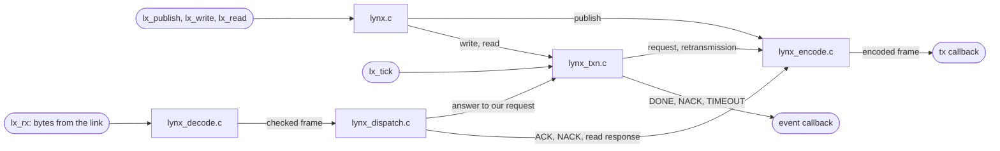
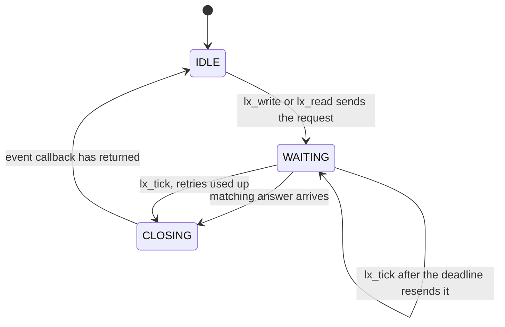

# How the code works

A map for reading the LYNX sources. The protocol itself (frame format, commands, guarantees) is
described in the [README](../README.md#frame-format). This page covers how the code implements
it: which file does what, and the path a frame takes through them.

## The files

Everything is in [`src/`](../src). Each `.c` file does one job:

| File | Job |
|---|---|
| [`lynx.h`](../src/lynx.h) | The public API: types, return codes, events, every function. |
| [`lynx_config.h`](../src/lynx_config.h) | Compile-time options and their defaults, critical-section hooks. |
| [`lynx.c`](../src/lynx.c) | API entry points: `lx_init`, `lx_bind`, `lx_get`/`lx_set`, `lx_publish`/`lx_write`/`lx_read`. **Start reading here.** |
| [`lynx_encode.c`](../src/lynx_encode.c) | Variables → bytes. Builds frames, running CRC and COBS in the same pass. |
| [`lynx_decode.c`](../src/lynx_decode.c) | Bytes → frames. COBS-decodes and checks the CRC as each byte arrives. Also the `LX_ISR_SAFE` byte queue. |
| [`lynx_dispatch.c`](../src/lynx_dispatch.c) | Frame → action. Commits received values, sends ACK / NACK / read responses, passes answers to our own requests on to `lynx_txn.c`. |
| [`lynx_txn.c`](../src/lynx_txn.c) | The reliable write or read in flight: sequence numbers, retries, timeout, exactly one event. |
| [`lynx_internal.h`](../src/lynx_internal.h) | Shared by the `.c` files only: command codes, transaction states, the functions files call in each other (named `lx__*`). |

Suggested reading order: `lynx.h` → `lynx.c` → `lynx_encode.c` → `lynx_decode.c` →
`lynx_dispatch.c` → `lynx_txn.c`.



## Following one reliable write

Node A writes a `float` (variable id 1, value 21.5) to node B. The bytes below are what the
library actually produces (default build).

**1. `lx_write(&A, LX_BIT(1))`** in `lynx.c` checks that variable 1 is bound and fits in a frame
(`lx__check_vars`), then hands over to `lx__txn_begin`.

**2. `lynx_txn.c`** takes the next sequence number (SEQ, here 1) and, under the lock, records the
transaction in the handle: `p_cmd = CMD_WRITE`, `p_mask`, `p_seq`, and a deadline
`LX_TIMEOUT_MS` from now. Then it asks `lynx_encode.c` for the request.

**3. `lynx_encode.c`** builds the frame. The raw frame is never stored anywhere:

```
11            HDR = CMD 1 (WRITE) << 4 | SEQ 1
01            ID  = variable 1
00 00 AC 41   the variable's 4 bytes (21.5f as it sits in memory)
FB 93         CRC-16 of everything above, high byte first
```

Each byte goes through the CRC and then the COBS encoder as it is produced. COBS removes every
`0x00`, so that `0x00` can mark the end of a frame. It splits the output into blocks, each
starting with a code byte that says how far it is to the next zero:

```
03 11 01 | 01 | 05 AC 41 FB 93 | 00
```

`03`: two data bytes, then a zero. `01`: no data, then another zero. `05`: four data bytes, then
the end. `00`: frame delimiter. Those 10 bytes go to the `tx()` callback.

**4. On node B**, every byte goes to `lx_rx` → `rx_byte` in `lynx_decode.c`, which undoes the
COBS step into `rx_buf` and updates the CRC with each decoded byte. When the `00` arrives the
work is already done. Running the CRC over a frame *and its own CRC* gives 0 when nothing was
corrupted, so the check is just `rx_crc == 0`.

**5. `lynx_dispatch.c`** reads `CMD = WRITE` and calls `on_write`. Variable 1 is bound and is
4 bytes, so it commits: `memcpy` into B's variable and sets bit 1 in `updated` (what
`lx_take_updates` returns). Then it answers with an ACK carrying the same SEQ:
`71 01 36 46` raw, `05 71 01 36 46 00` on the wire.

**6. Back on node A**, the ACK goes through the same decoder to `on_ack`. `lx__txn_claim` checks
that it really answers the request in flight (an ACK, SEQ 1, and on a bus from node B) and
closes the transaction. `lx__txn_finish` calls the event callback with `LX_EV_DONE`, mask `0x2`,
and only then marks the handle idle.

**If the ACK is lost**, `lx_tick` on node A finds the deadline has passed and sends the same
request again, up to `LX_RETRIES` times. Then it closes the transaction with `LX_EV_TIMEOUT`. If
B received the write but its ACK was lost, B simply commits the same value again and re-ACKs.

A publish is just steps 1, 3, 4 and 5 without the transaction or the answer. A read works like a
write: B answers a `READ` with a `READ_RSP` carrying its value, which A commits in `on_read_rsp`.

## The transaction in flight

One write or read can be in flight per handle. Its state is the byte `h->p_cmd`:



`WAITING` is stored as the request's command (`CMD_WRITE` or `CMD_READ`), so an ACK can only
complete a write and a `READ_RSP` only a read. `lx_busy()` is true in `WAITING` and `CLOSING`.
The `CLOSING` step exists for threaded builds. Without it, another task could start a new
transaction while the callback was still reporting the old one, and take that event for its own.

Answers are matched on command, SEQ (4 bits, so a late answer to an earlier request is
ignored) and, in bus mode, the sender's address.

## The receive decoder

`lynx_decode.c` keeps its state in six fields of `lx_t`, so every byte costs the same small
amount of work and there is never a second pass over the frame:

| Field | Meaning |
|---|---|
| `rx_buf`, `rx_len` | the decoded frame so far |
| `rx_crc` | CRC over `rx_buf`; 0 at the end means the frame is intact |
| `rx_code` | code byte of the current COBS block (0 = nothing received since the last `0x00`) |
| `rx_rem` | data bytes still to come in that block |
| `rx_drop` | this frame is already lost (too long, or bytes missing): ignore everything until the next `0x00` |

A frame is accepted only if nothing was dropped, the last block is complete, it is long enough
to hold a header and a CRC, and the CRC residue is 0. Line noise therefore costs the frame it
hits, and at most the next one (none with `LX_LEAD_DELIM=1`).

## Two contexts: the RX path and the app path

A handle can be used from two places at once, for example a UART receive task or ISR and the
main loop:

- the **RX path**: `lx_rx`, or `lx_poll` with `LX_ISR_SAFE`. It runs `lynx_decode.c`,
  `lynx_dispatch.c` and the answer half of `lynx_txn.c`;
- the **app path**: every other call.

They share three things, and every access to them is inside `LX_ENTER_CRITICAL()` /
`LX_EXIT_CRITICAL()`. There are ten such sections, all short, and none of them nest:

| Shared state | Critical sections |
|---|---|
| The transaction (`p_cmd`, `p_mask`, ...) | `lx__txn_begin`, the decision in `lx_tick`, `lx__txn_claim`, `on_read_rsp` |
| The bound variables | `enc_var` (copy out while encoding), `on_write`, `on_write_batch`, `on_read_rsp` (commit), `lx_get`, `lx_set` |
| The update flags | the commits above, `lx_take_updates` |

The rest is owned by one side: the RX path writes the decoder fields, `rsp_buf`, `st_rx_ok`,
`st_rx_bad` and `st_rsp`, and the app path writes `tx_buf`, `st_tx` and `st_retx`. Replies use
their own buffer (`rsp_buf`), so an ACK sent from the RX path can never overwrite a frame the app
is in the middle of sending.

With `LX_ISR_SAFE=1`, `lx_rx` only appends to a lock-free queue (the end of `lynx_decode.c`)
and everything else runs in the task that calls `lx_poll`. No locks are needed at all.

## Bus mode

With `LX_BUS=1` every frame carries `[DST][SRC]` after the header. The filtering is in
`for_us()` in `lynx_dispatch.c`. The sender's address is threaded through the functions that
build or match frames, with these two macros from `lynx_internal.h`:

```c
uint16_t lx__build_vars(lx_t *h, uint8_t *buf, uint8_t cmd, uint8_t seq, uint32_t mask
                        BUS_ADDR_PARAM(dst));      /* bus: ..., uint8_t dst)   point-to-point: ...) */
lx__build_vars(h, buf, CMD_PUB, 0, mask BUS_ADDR_ARG(h->peer));
```

In a point-to-point build they expand to nothing. The parameter doesn't exist, so bus mode
costs no code when it is off.

## Changing the protocol

To add a command:

1. Add its code to the `CMD_*` list in `lynx_internal.h` (4 bits; 9 to 14 are free, 0 and 15
   are taken by the transaction states `TXN_IDLE` and `TXN_CLOSING`).
2. Build it in `lynx_encode.c`: `lx__build_short` covers frames with no variable data,
   `lx__build_vars` frames that carry variables.
3. Handle it in the `switch` at the end of `lynx_dispatch.c`.
4. If it expects an answer, make it a transaction (`lx__txn_begin`) so it gets retries,
   a timeout and its event for free.

Then run `tools/run_tests.sh`. It builds every configuration warning-free and runs the tests
under AddressSanitizer, UndefinedBehaviorSanitizer and ThreadSanitizer.
